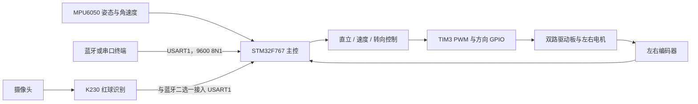

# STM32F767 双轮自平衡小车

基于 **STM32F767IGT6 + MPU6050 + 双编码器电机** 的双轮自平衡小车，提供直立、速度和转向控制，以及蓝牙/串口遥控。搭配 K230 可运行红球识别、转向对准与向前推球示例。

STM32 负责实时平衡，K230 负责视觉决策，两者通过串口传递运动指令。适合学习嵌入式开发、反馈控制和视觉与运动控制的协同实现。

## 先看这里

| 你想做什么 | 对应资料 |
| --- | --- |
| 接线、准备硬件 | [硬件与引脚](docs/hardware.md) |
| 编译、烧录、首次启动 | [快速上手](docs/getting-started.md) |
| 理解控制流程、调整 PID | [控制原理与调参](docs/control.md) |
| 用串口或蓝牙发指令 | [通信协议](docs/protocol.md) |
| 运行 K230 红球示例 | [K230 视觉扩展](docs/k230.md) |
| 查看已检查项目和当前限制 | [验证记录](docs/validation.md) |
| 了解授权范围和第三方来源 | [许可与第三方说明](THIRD_PARTY_NOTICES.md) |

## 实现了什么

- MPU6050 DMP 输出姿态，以 100 Hz 配置触发控制计算。
- 直立 PD、速度 PI、转向控制相加，形成左右电机 PWM。
- TIM4/TIM5 读取增量编码器；TIM3 两路 PWM 驱动电机。
- USART1 支持前进、后退、左右转向、原地旋转和 PID 查询/调整。
- 保留 USB CDC 调试接口，可在源码中切换 `printf` 输出方式。
- K230 运行颜色阈值视觉示例，完成定时前进、停车、识球、对准和推球。

## 系统结构



## 快速开始

1. 准备 STM32F767IGT6 开发板、MPU6050、双路电机驱动板、两台带编码器的减速电机及合适的电源。
2. 按 [接线表](docs/hardware.md) 连接模块，确认共地和供电电压。
3. 安装 Keil MDK、ARM Compiler 5 和 `Keil.STM32F7xx_DFP`，打开 `MDK-ARM/STM32F767-balance-car.uvprojx`。
4. Rebuild 后通过 ST-LINK 下载；将 USART1 终端设为 **9600、8N1**，观察 `MPU 6050 init ok`、`DMP init ok` 和 `STM32_READY`。
5. 先架空检查电机和编码器方向，再按 [调参步骤](docs/control.md) 调整机械中值及控制参数。
6. 需要视觉功能时，再将 `K230_Part.py` 部署到兼容的 CanMV K230 环境。

详细步骤见 [快速上手](docs/getting-started.md)。默认参数来自现有车体，换底盘后需要重新标定。首次运行应架空车轮并准备切断电机电源；当前程序没有完善的摔倒保护或通信失联停车机制。

## 代码地图

```text
.
├── Core/                       STM32 初始化、主循环及中断入口
├── Drivers/
│   ├── BSP/
│   │   ├── Bluetooth/          串口收包、遥控与 PID 协议
│   │   ├── Motor/              电机方向与 PWM 限幅
│   │   ├── MPU6050/            MPU6050 驱动和 eMPL/DMP 代码
│   │   ├── PID/                直立、速度与转向控制
│   │   ├── Key/                预留按键代码
│   │   └── IIC_Software/       未加入当前 Keil 目标的历史软件 I2C
│   ├── CMSIS/                  ARM 核心与设备支持
│   └── STM32F7xx_HAL_Driver/    STM32 HAL
├── Middlewares/ST/             USB Device CDC 中间件
├── USB_DEVICE/                 USB CDC 配置与接口
├── MDK-ARM/                    Keil 工程、启动文件与调试配置
├── STM32F767-balance-car.ioc    STM32CubeMX 配置
├── K230_Part.py                K230 视觉寻球程序
├── docs/                       接线、复现、控制、协议与验证说明
├── tools/render_balance_car_schematic.py  连接图生成脚本
└── 双轮平衡车完整电气连接原理图.png
```


连接图为模块级示意，具体引脚以 [接线表](docs/hardware.md) 和当前源码为准。仓库不含 PCB、结构 CAD、实体演示视频及其他课题资料。编译缓存和与本项目无关的报告生成工具由 `.gitignore` 排除，现有本地文件仍保留。

## 当前边界

当前版本为裸机主循环程序，不包含 RTOS、目标距离估计或独立踢球执行机构。红球功能使用 LAB 颜色阈值，效果受光照和背景影响。协议解析、异常处理和控制保护仍有改进空间；源码可复现性检查与实际整车测试的范围详见 [验证记录](docs/validation.md)。

## 参与和许可

反馈问题时请提供开发板、接线、Keil/编译器版本、启动日志和复现过程，参见 [贡献说明](CONTRIBUTING.md)。

本次新增的说明文档使用 [MIT License](LICENSE)。既有固件、K230 脚本、驱动和中间件保留原作者权利及适用许可，**不统一改授 MIT**。特别是 InvenSense eMPL 文件引用的 `License.txt` 在原始目录中缺失，不能仅凭本仓库认定该组件获得开源或再分发授权，详见 [第三方说明](THIRD_PARTY_NOTICES.md)。
