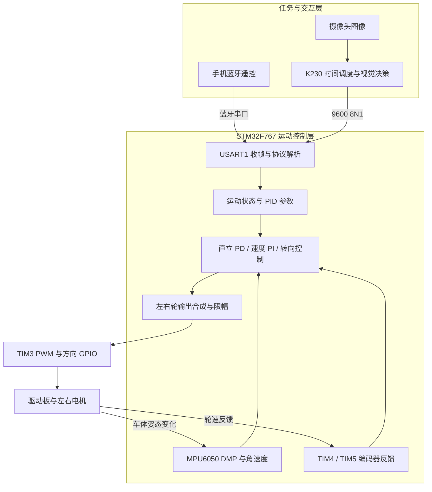

# STM32F767 双轮平衡车：飞坡与视觉寻球推球

**基于 STM32F767 与 K230 的机电一体化综合项目，围绕动态平衡、斜坡通行、落地恢复和视觉目标交互，完成从底层驱动到任务决策的系统集成。**

项目采用 STM32F767IGT6 作为运动控制主控，结合 MPU6050 姿态测量、双轮增量编码器和双路电机驱动，构建直立、速度与转向控制。在此基础上，通过蓝牙实现人工遥控，并接入 K230 摄像头与视觉程序，组织“定时前进飞坡 → 落地停止 → 切换平衡中值 → 搜索红球 → 转向对准 → 前进推球”的连续任务。

项目的主要工作集中在多个环节的协同：倾角和轮速反馈的符号统一、机械重心与平衡工作点匹配、运动指令平滑接入、落地后的阶段切换，以及视觉识别和串口通信对平衡控制时序的影响。STM32 持续负责底层闭环，K230 则根据任务阶段和图像结果改变运动目标。

`STM32F767` · `Cortex-M7` · `STM32 HAL` · `MPU6050 / DMP` · `PD / PI 控制` · `编码器反馈` · `CanMV K230` · `LAB 颜色识别` · `串口协议` · `任务状态机`

## 阅读导航

| 阅读目的 | 入口 |
| --- | --- |
| 了解项目目标与主要工作 | [双任务设计](#双任务设计)、[工程工作与实现要点](#工程工作与实现要点) |
| 理解系统如何协同 | [系统架构](#系统架构)、[平衡与运动控制](#平衡与运动控制) |
| 理解飞坡到推球的连续流程 | [K230 任务调度与视觉决策](#k230-任务调度与视觉决策) |
| 查看工程难点和取舍 | [关键工程问题与设计取舍](#关键工程问题与设计取舍) |
| 自己接线和运行 | [硬件与引脚](docs/hardware.md)、[快速上手](docs/getting-started.md) |
| 深入调整参数或接入上位机 | [控制与调参](docs/control.md)、[通信协议](docs/protocol.md)、[K230 配置](docs/k230.md) |
| 确认检查范围和授权情况 | [验证记录](docs/validation.md)、[第三方说明](THIRD_PARTY_NOTICES.md) |

## 双任务设计

项目以双轮自平衡为共同基础，组织两种决策方式不同的任务。

### 任务一：蓝牙操控飞坡

由操作者观察场地，通过手机蓝牙发送前进、后退、左右转向和停止指令，完成对准斜坡、前进通行与落地后停止。STM32 在运动过程中继续执行姿态和轮速反馈控制。

这一任务同时涉及基础运动调试与瞬态恢复：车体既要响应前进目标，又要在坡面和落地扰动后回到可控状态。运动指令通过速度和转向目标进入控制器，最终与直立控制量共同形成电机输出。

### 任务二：飞坡后视觉寻球与推球

K230 按预定时间推进飞坡阶段，发送停止命令并切换 STM32 的平衡中值，然后进入视觉任务。检测到红色目标后，根据其在图像中的水平偏差选择转向或前进；目标短暂丢失时，结合最近位置继续搜索。

| 对比项 | 蓝牙操控任务 | K230 视觉任务 |
| --- | --- | --- |
| 运动决策来源 | 操作者与手机蓝牙端 | K230 时间调度与视觉决策 |
| 斜坡对准方式 | 人工观察和微调 | 依赖预设起点、朝向与定时直行 |
| 飞坡阶段 | 人工发送前进指令 | 自动维持前进阶段 4.5 s |
| 落地后处理 | 人工发送停止并观察回稳 | 停止 1.0 s，再切换平衡中值 |
| 后续动作 | 遥控运动与稳定性调试 | 识球、确认、搜索、对准和推球 |
| 共用部分 | STM32、MPU6050、编码器、控制算法、电机驱动与指令解析 | 同左 |

飞坡流程面向固定场地标定：当前程序没有坡面位置识别、离地检测或落地传感器，阶段切换依据时间。这里的推球由车体前进完成，没有独立踢球执行机构。

## 工程工作与实现要点

| 工作方向 | 具体实现 | 在整车中的作用 |
| --- | --- | --- |
| 硬件接口与底层驱动 | 配置 I2C、外部中断、编码器定时器、PWM、方向 GPIO 和 USART | 将传感器、执行器与上层控制接通 |
| 姿态获取与坐标适配 | 接入 MPU6050 DMP、FIFO 和安装方向配置，将 Q30 四元数转换为欧拉角 | 向直立控制提供俯仰角，结合陀螺仪数据形成反馈 |
| 直立与运动控制 | 直立 PD、速度 PI、按运动状态切换的转向控制，合成左右轮输出 | 在保持平衡的同时执行前后运动和差动转向 |
| 反馈与输出约束 | 编码器符号处理、一阶低通、速度目标渐变、积分限幅、PWM 限幅 | 协调传感器方向、运动突变与执行器输出范围 |
| 通信与在线调试 | ASCII 帧收发、运动状态映射、PID 查询/修改/恢复、可切换打印接口 | 让遥控端和视觉端复用同一套底层运动接口 |
| 视觉感知 | LAB 阈值、色块合并与筛选、最大色块选择、连续帧确认 | 从摄像头图像中提取可供运动决策使用的目标位置 |
| 任务阶段协调 | 定时前进、落地停止、平衡中值切换与视觉模式等待 | 将飞坡和推球组织为有明确过渡的连续任务 |
| 目标丢失处理 | 短时保持、按最近目标方向搜索、超时后默认搜索 | 避免每次漏检都立刻改变搜索方向 |
| 复现与验证整理 | 接线图、参数说明、独立源码导出编译、仓库完整性检查 | 让其他开发者能够理解并复现当前工程 |

这些工作包含对 HAL、CMSIS 和 InvenSense 等既有组件的集成与适配；具体第三方边界见 [许可说明](THIRD_PARTY_NOTICES.md)。

## 系统架构

### 按职责分层

STM32 执行裸机主循环，负责与姿态采样同步的控制计算；K230 负责图像采集、目标识别、显示和任务阶段决策。视觉端发送运动意图，具体电机方向和 PWM 由 STM32 根据当前反馈计算。



蓝牙、K230 和 USB 转 TTL 共用 PA9/PA10 时，选择一个主动发送端接入。图中的两条指令路径表示可选模式，当前硬件连接和程序没有实现多发送端仲裁。

### 硬件资源分配

| 资源 | 当前配置 | 承担的功能 |
| --- | --- | --- |
| MCU 与时钟 | STM32F767IGTx；25 MHz HSE，系统时钟 216 MHz | 姿态读取、控制计算及外设管理 |
| I2C1 | PB8 SCL、PB7 SDA | MPU6050 寄存器与 FIFO 访问 |
| EXTI4 | PH4，下降沿 | MPU6050 数据就绪通知 |
| TIM3 | PA6 CH1、PA7 CH2；周期 21599 | 右/A 路与左/B 路 PWM |
| TIM4 | PD12 CH1、PD13 CH2 | 右轮编码器 |
| TIM5 | PH10 CH1、PH11 CH2 | 左轮编码器 |
| 方向输出 | PI5/PI6、PG13/PG14 | 分别控制右/A 路与左/B 路方向 |
| USART1 | PA9 TX、PA10 RX；9600 8N1 | 蓝牙遥控、视觉命令与调试输出 |
| USB Device | CDC 接口，按宏切换打印 | 可选虚拟串口调试 |
| K230 UART1 | GPIO40 TX、GPIO41 RX | 与 STM32 交换串口数据 |

完整供电、接线顺序和模块要求见 [硬件与引脚](docs/hardware.md)。


此图为模块级连接示意，具体引脚以接线表和源码为准。电池、驱动板、电机及各模块的供电电压需要按实物规格确认。

## 平衡与运动控制

### 1. 从姿态数据到一次控制计算

MPU6050 驱动完成传感器、FIFO、DMP 固件、安装方向和输出速率配置。`mpu_dmp_get_data()` 读取 DMP 四元数，将 Q30 定点数据转换为浮点数，再计算 `pitch / roll / yaw`；主循环另行读取陀螺仪原始数据，用于直立阻尼和转向反馈。

`DEFAULT_MPU_HZ=100`，对应约 10 ms 的目标更新周期。PH4 中断只设置标志，把 I2C 访问和控制计算留在主循环：

```text
MPU6050 数据就绪 → PH4 中断置位
    → 主循环读取姿态与角速度
    → 读取左右编码器，并清零本周期计数
    → 计算直立、速度和转向控制量
    → 合成左右 PWM，限幅并输出
```

这种组织方式缩短了中断内的执行路径。实际控制周期仍受 I2C 访问、串口发送等主循环操作影响，100 Hz 是配置目标，尚无周期抖动实测数据。

### 2. 直立 PD：控制车体倾角

车体重心位于轮轴上方，姿态偏离平衡位置时，需要通过车轮运动纠偏。代码使用俯仰角 `pitch` 和 Y 轴角速度 `gy`：

```text
Angle_bias = Mid_Angle - pitch
Gyro_bias  = -gy
Vertical_out = -Balance_Kp × Angle_bias - Balance_Kd × Gyro_bias
```

比例项根据倾角偏差形成恢复输出，角速度项提供阻尼。`gy` 使用原始读数，参数数值与传感器量程和安装朝向有关。MPU 坐标、左右电机方向和编码器正负号必须匹配；错误符号会使纠偏形成正反馈。

### 3. 速度 PI：约束漂移并接入运动目标

TIM4 和 TIM5 按控制周期提供编码器增量。左轮计数取负，右轮按有符号 16 位值读取，再由左右反馈形成速度控制输入：

```text
Encoder_Least = -(left_encoder + right_encoder)
Encoder_bias = 0.84 × Encoder_bias + 0.16 × Encoder_Least
Encoder_Integral += Encoder_bias + Movement
Encoder_Integral 限制在 [-8000, 8000]
Velocity_out = Velocity_Kp × Encoder_bias + Velocity_Ki × Encoder_Integral
```

一阶低通平滑轮速反馈，积分用于修正持续偏差。前进和后退状态改变 `Movement_Target`，`Movement` 每次控制计算以 1.5 为步长向目标调整，减缓指令突变。当前速度数值采用编码器与控制器内部尺度，未换算为 m/s。

### 4. 转向与左右轮输出合成

普通左右转与原地旋转对应不同的转向目标幅度。前进、后退时加入 Z 轴角速度反馈；其他状态将该反馈系数置零。各部分输出按下式叠加：

```text
Turn_out    = Turn_Target × Turn_Kp + gz × Kd
PWM_out     = Vertical_out + Velocity_out
Motor_L_PWM = PWM_out + Turn_out
Motor_R_PWM = PWM_out - Turn_out
```

左右轮通过差动输出实现转向，电机层将每路 PWM 限制在 `[-21599, 21599]`。当前实现把速度输出直接叠加到直立输出上，理解或修改算法时应以实际公式为准。

### 5. 分阶段平衡工作点

`Mid_Angle` 表示当前车体所需的平衡参考，受 MPU 安装偏差、车架、摄像头支架和电池位置影响。代码上电时使用 `-7°`；K230 在落地停止后发送 `$5,...#`，将其改为 `0.2°` 并把运动状态设为停止，再进入推球任务。

这使同一底层控制器能够按任务阶段改变工作点。两个角度是当前车体的标定值，换车架或重心后需要重新确定；切换结果只保存在 RAM，复位后恢复源码初值。

| 参数组 | 当前默认值 | 代码入口 |
| --- | --- | --- |
| 直立 PD | `Kp=800`，`Kd=4.8` | `Balance_PD()` |
| 速度 PI | `Kp=300`，`Ki=1.5` | `Velocity_PI()` |
| 转向控制 | `Kp=200`，`Kd=5` | `Turn_PD()` |
| 机械中值 | 上电 `-7°`；视觉任务切换为 `0.2°` | `Mid_Angle`、`Protocol()` |
| 运动幅度 | 前后目标 `100`；普通转向目标 `20` | `Car_Target_Velocity`、`Car_Turn_Amplitude_speed` |

参数定义位于 [pid.c](Drivers/BSP/PID/pid.c)，详细调参顺序见 [控制原理与调参](docs/control.md)。

## K230 任务调度与视觉决策

### 飞坡、落地与模式切换

K230 用经过时间划分前半段任务，将需要不同动作的阶段明确分开：


按当前参数，约在启动 6.75 s 后进入视觉决策。这里的时间不表示检测到了真实落地；其中 4.5 s 是前进指令维持时间，涵盖预设起点到坡面及落地后的运动过程，需要结合起点距离、电池状态和车体速度重新标定。

落地停止阶段给控制器留出恢复时间，随后再切换机械中值和启用寻球，减少任务切换时多个动作同时叠加。

### 图像处理链路

程序采用颜色与色块方法，处理流程集中在 `find_ball()` 等函数中：

```text
640×480 RGB565 图像采集
    → 缩小到 320×240
    → LAB 红色阈值提取
    → 最小像素数 / 面积过滤与色块合并
    → 选择像素数最大的色块
    → 连续帧确认与中心偏差计算
    → 生成运动指令，在原图叠加检测框和状态
```

小图用于检测，检测框和中心点按比例映射回显示图，以兼顾处理负担与现场调试可读性。屏幕同时显示任务阶段、指令前缀和运行时间，便于核对“看见了什么、当前决定做什么”。

### 连续确认、居中判断与丢失搜索

| 情况 | 当前处理 | 设计目的 |
| --- | --- | --- |
| 检出目标但连续帧数不足 6 | `CONFIRM`，停止运动目标 | 减少单帧噪声造成的动作切换 |
| 连续检出且水平偏差绝对值小于 60 像素 | `PUSH`，前进 | 在中心区域内保持推球动作 |
| 连续检出但目标偏左/偏右 | `AIM LEFT / RIGHT`，转向 | 根据图像水平误差调整朝向 |
| 目标刚丢失，距上次检出不足 0.35 s | `LOST PUSH`，短暂继续前进 | 允许短时漏检时动作保持连续 |
| 丢失持续到 1.2 s 以内 | 按目标最后所在侧原地搜索 | 利用最近位置缩小搜索方向范围 |
| 丢失超过 1.2 s | 默认原地左旋搜索 | 继续获取目标 |

60 像素死区基于 **320×240 检测图**，不能直接按 640×480 显示图理解。连续确认累计的是“每帧存在候选色块”，当前没有跨帧目标身份关联，也没有圆形几何验证；颜色相近的其他物体仍可能被选中。

普通阶段设置 `SEND_INTERVAL=0.25 s`；`PUSH` 和 `AIM LEFT/RIGHT` 分支使用强制发送，会绕过这个间隔。串口负载与实际帧率需要一同检查，不能把 0.25 s 视为所有状态统一的发送周期。

详细参数、固件与显示配置见 [K230 视觉扩展](docs/k230.md)。

## 通信接口与在线调试

### 统一的运动指令入口

蓝牙和 K230 均使用以 `$` 开头、以 `#` 结束的 ASCII 帧。USART1 中断逐字节收包，完整帧交给主循环解析，映射为统一的运动状态。

| 功能 | 指令例子 |
| --- | --- |
| 停止运动目标，保留平衡控制 | `$0,0,0,0,0,0,0,0,0,0#` |
| 前进 | `$1,0,0,0,0,0,0,0,0,0#` |
| 普通左转 | `$3,0,0,0,0,0,0,0,0,0#` |
| 原地左旋 | `$0,1,0,0,0,0,0,0,0,0#` |
| 切换视觉任务平衡中值 | `$5,0,0,0,0,0,0,0,0,0#` |
| 查询 PID | `$0,0,1,0,0,0,0,0,0,0#` |

通过统一状态接口，人工遥控与视觉决策可以复用 `Balance_PD()`、`Velocity_PI()` 和 `Turn_PD()`，无需为两种任务分别编写电机控制逻辑。

### PID 查询、修改与恢复

协议支持读取、修改和恢复启动时保存的六个 PID 参数。例如，将三组参数设置为当前默认值：

```text
$0,0,0,0,1,1,1,AP8.0,AD4.8,VP3.0,VI1.5,TP2.0,TD5.0#
```

`AP/VP/TP` 接收后乘以 100，`AD/VI/TD` 直接使用。运行中参数只更新 RAM，未写入 Flash；恢复 PID 也不恢复 `Mid_Angle`。

`USB_CDC_PRINTF` 可选择 USART1 或 USB CDC 打印路径。查询与打印存在阻塞开销，调试时需要兼顾观察信息与控制时序。完整字段、响应和实现限制见 [通信协议](docs/protocol.md)。

## 关键工程问题与设计取舍

| 工程问题 | 当前采用的处理 | 需要理解的取舍 |
| --- | --- | --- |
| 车体倾角、编码器和电机方向需要统一 | 安装方向配置、左轮计数取负、分路控制电机方向 | 参数调节建立在反馈符号正确的基础上，移植时必须重新核对 |
| 指令突变与轮速噪声影响运动平顺性 | 速度目标渐变、反馈低通、积分和 PWM 限幅 | 能约束目标变化和输出，但不能代替完善的倾倒与故障保护 |
| 飞坡与落地后推球的工作条件不同 | 显式停止阶段、机械中值由 -7° 切换到 0.2° | 切换依赖场地时间标定，当前没有姿态稳定判据 |
| 金属坡面反光使简单颜色判断不稳定 | 飞坡阶段采用预先标定的定时直行，视觉集中用于后续目标球 | 固定场地实现更直接，对起点、朝向和电池变化更敏感 |
| 视觉漏检容易导致动作频繁切换 | 连续 6 帧确认、中心死区、分阶段丢失搜索 | 增加确认等待；短时继续前进也要求预留足够场地 |
| 旋转搜索与前进推球需要不同运动意图 | 区分普通转向、原地旋转与前进指令 | 原地旋转时底层平衡仍持续工作，仍可能受中值和积分状态影响而漂移 |
| 视觉、显示与平衡控制执行节奏不同 | 两处理器按职责分工；中断收包、主循环处理；常规发送节流 | STM32 仍会受串口阻塞影响，强制发送分支尚需实机评估 |
| 调试现象可能来自多个环节 | 按反馈方向、中值、直立、速度、转向、视觉任务顺序分层检查 | 先隔离问题再组合，避免同时修改多组参数导致原因不清 |

其中坡面识别的取舍来自项目设计资料；控制计算、阶段切换和视觉策略已按当前源码核对。仓库未附成功率、落地恢复时间或轨迹误差等原始实测记录，因此不以这些指标宣称性能。

## 快速复现

### 开发环境

| 部分 | 环境 |
| --- | --- |
| STM32 固件 | Windows、Keil MDK/uVision、ARM Compiler 5 |
| 器件支持 | `Keil.STM32F7xx_DFP.2.7.0` 及工程所需 CMSIS CORE 组件 |
| 配置文件 | STM32CubeMX `.ioc`，编译现有工程无需先重新生成 |
| 下载与调试 | ST-LINK；串口终端使用 9600 8N1 |
| K230 | 提供 `media.*` 与 `machine.UART/FPIOA` API 的兼容 CanMV 固件 |
| 可选图示工具 | Python、Pillow、Windows 宋体字体 |

### 上手步骤

```sh
git clone https://github.com/BGrowl/STM32F767-balance-car.git
cd STM32F767-balance-car
```

1. **硬件检查：** 按 [接线表](docs/hardware.md) 连接模块，确认共地、供电、STBY 使能及 UART 电平。
2. **固件构建：** 打开 `MDK-ARM/STM32F767-balance-car.uvprojx`，确认器件与编译器后执行 Rebuild。
3. **烧录启动：** 通过 ST-LINK 下载，观察 USART1 的 `MPU 6050 init ok`、`DMP init ok` 和 `STM32_READY`。
4. **底层验证：** 架空检查电机与编码器方向，确认 MPU 姿态轴；再扶稳车体标定中值和直立参数。
5. **运动调试：** 依次接入速度环、转向和蓝牙指令，确认停止目标、前后运动与原地旋转的行为。
6. **任务标定：** 在固定起点和场地调整前进时长、落地等待和阶段中值，之后再启用视觉寻球。
7. **视觉联合调试：** 部署 `K230_Part.py`，标定 LAB 阈值，核对显示状态、串口指令和整车动作。

首次运行应架空车轮并准备切断电机功率电源。停止命令仍保留平衡输出，不能作为断电急停。换车架、电机、摄像头支架或电池位置后，应重新确认机械中值与 PID。

更多日志说明与故障排查见 [快速上手](docs/getting-started.md)。

## 代码地图与阅读顺序

```text
.
├── Core/
│   ├── Src/main.c              初始化、数据就绪处理与控制主循环
│   ├── Src/tim.c               PWM 与两路编码器配置
│   ├── Src/i2c.c               MPU6050 硬件 I2C
│   ├── Src/usart.c             USART1 初始化
│   └── Src/gpio.c              方向 GPIO 与外部中断配置
├── Drivers/
│   ├── BSP/
│   │   ├── Bluetooth/          帧接收、运动状态与 PID 协议
│   │   ├── Motor/              左右电机方向、PWM 与限幅
│   │   ├── MPU6050/            寄存器访问、eMPL/DMP 与姿态转换
│   │   ├── PID/                直立 PD、速度 PI 与转向控制
│   │   ├── Key/                预留按键代码
│   │   └── IIC_Software/       未加入当前目标的历史软件 I2C
│   ├── CMSIS/                  ARM 核心与设备支持
│   └── STM32F7xx_HAL_Driver/    STM32 HAL
├── Middlewares/ST/             USB Device CDC 中间件
├── USB_DEVICE/                 USB CDC 配置与接口
├── MDK-ARM/                    Keil 工程、启动文件与调试配置
├── STM32F767-balance-car.ioc    STM32CubeMX 配置
├── K230_Part.py                飞坡时序、视觉检测、对准和搜索决策
├── docs/                       详细接线、复现、控制、协议与验证说明
├── tools/
│   ├── check_repository.py     源码包与文档完整性检查
│   └── render_balance_car_schematic.py  模块连接图生成
├── .github/workflows/          GitHub Actions 检查
└── 双轮平衡车完整电气连接原理图.png
```

建议阅读顺序：

1. [main.c](Core/Src/main.c)：把握初始化、反馈采集与控制调用顺序。
2. [pid.c](Drivers/BSP/PID/pid.c)：理解三部分控制输出及运动状态的作用。
3. [motor.c](Drivers/BSP/Motor/motor.c)：核对左右轮映射、正反转和 PWM。
4. [app_bluetooth.c](Drivers/BSP/Bluetooth/app_bluetooth.c)：理解命令如何改变状态、参数与中值。
5. [K230_Part.py](K230_Part.py)：串起时间阶段、视觉检测与运动决策。
6. [inv_mpu.c](Drivers/BSP/MPU6050/eMPL/inv_mpu.c)：深入 DMP 初始化与姿态转换。

仓库保留当前工程源码和必要支持文件，不包含 PCB、结构 CAD、实体演示视频或其他课题资料。编译缓存、个人调试配置及无关报告工具通过 `.gitignore` 排除。

## 验证情况与后续改进

### 已完成的发布验证

| 项目 | 结果与范围 |
| --- | --- |
| Keil 完整重编译 | ARM Compiler 5.06 update 3；0 errors、0 warnings |
| 独立源码导出构建 | 从 Git 提交导出到独立目录后再次重编译成功 |
| 工程文件完整性 | Keil 目标列出的 47 个源文件路径全部存在 |
| 文档与 Python 检查 | 本地链接、必要文件和 Python AST 语法检查通过 |
| GitHub Actions | 在 push / PR 时运行仓库完整性检查 |

完整记录见 [发布前验证](docs/validation.md)。以上构建检查完成于 2026-10-19；本次仓库整理没有重新连接实车或 K230，也没有新增整车性能测试。

### 后续可完善的方向

- 增加倾倒停机、传感器故障处理、积分复位、欠压和通信失联保护。
- 以真实落地与姿态稳定判据替代部分固定时间切换，提高场地适应性。
- 加强串口帧校验、缓冲区边界和中断/主循环共享数据保护，减少阻塞发送。
- 增加目标几何过滤、跨帧关联或距离信息，并完善多状态下的发送频率控制。
- 记录控制周期、姿态曲线、编码器数据和任务成功率，建立可比较的实验结果。

当前自动遥测函数尚未完成有效数据接入，不能作为已可用功能；K230 板卡型号与固件版本也有待补齐。

## 参与和许可

欢迎围绕控制保护、通信可靠性、任务判断与视觉鲁棒性提出改进。反馈时请附硬件配置、接线差异、编译环境、当前参数、日志及复现过程，参见 [贡献说明](CONTRIBUTING.md)。

新增说明文档使用 [MIT License](LICENSE)。既有固件、K230 脚本、驱动和中间件保留原作者权利及适用许可，不统一改授 MIT。InvenSense eMPL 文件引用的历史 `License.txt` 未随原项目附带，相关授权信息仍需补齐，详见 [第三方说明](THIRD_PARTY_NOTICES.md)。
