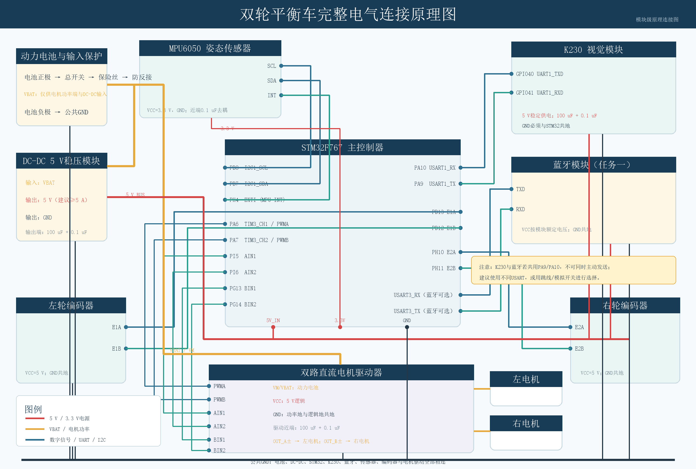

# 硬件与引脚

[返回首页](../README.md)

## 硬件清单

| 模块 | 要求或用途 |
| --- | --- |
| STM32F767IGT6 开发板 | 当前工程目标为 STM32F767IGTx，外部晶振配置为 25 MHz |
| MPU6050 模块 | I2C 接口，需引出 INT；确认模块供电与电平兼容 |
| 双路 H 桥驱动板 | 支持 PWMA/PWMB、AIN1/AIN2、BIN1/BIN2、STBY 的接口形式 |
| 两台减速电机 | 每台带 A/B 双相增量编码器 |
| 车架、车轮、电池及稳压模块 | 电压和额定电流按实物驱动板、电机与开发板确定 |
| ST-LINK | SWD 烧录和调试 |
| USB 转 TTL 或蓝牙串口模块 | 3.3 V 兼容逻辑电平；9600 8N1 |
| K230、摄像头、兼容显示屏（可选） | 当前脚本使用 CanMV API 和 ST7701 显示配置 |

没有提供精确采购型号、轮径、减速比或电池规格；复现时应记录自己的实物配置。

## STM32 信号连接

下表依据 `Core/Src/i2c.c`、`tim.c`、`usart.c`、`gpio.c` 和 `Drivers/BSP/Motor/motor.c`。

| 功能 | STM32 引脚 | 外设/模块信号 |
| --- | --- | --- |
| MPU6050 SCL | PB8 | I2C1_SCL |
| MPU6050 SDA | PB7 | I2C1_SDA |
| MPU6050 INT | PH4 | EXTI4，下降沿中断 |
| 右电机 PWM（A 路） | PA6 | TIM3_CH1 → PWMA |
| 右电机方向 | PI5、PI6 | AIN1、AIN2 |
| 右编码器 | PD12、PD13 | TIM4_CH1、TIM4_CH2；旧接线注释分别称 E1B、E1A |
| 左电机 PWM（B 路） | PA7 | TIM3_CH2 → PWMB |
| 左电机方向 | PG13、PG14 | BIN1、BIN2 |
| 左编码器 | PH10、PH11 | TIM5_CH1、TIM5_CH2；旧接线注释分别称 E2A、E2B |
| 串口发送 | PA9 | USART1_TX → 对端 RX |
| 串口接收 | PA10 | USART1_RX ← 对端 TX |
| 调试信号 | PD4 | 主循环翻转 GPIO，不代表稳定采样时钟 |

电机“左/右”以 `motor_control_L/R()` 的实现为准，不要只按电机线上的“1/2”编号判断。左编码器在主循环中取负号；右编码器按有符号 16 位计数读取。交换相线或编码器线会改变反馈方向，应先架空验证。

## 供电和连接顺序

1. 断电接线。先确认驱动板的 VM/电机电源端和逻辑电源端，再按实物规格供电。
2. STM32、编码器、MPU6050、驱动板和串口设备必须共地。
3. MPU6050 裸芯片与带稳压模块的供电要求不同；不要直接照旧注释把所有模块接到 5 V。I2C 上拉和 UART 逻辑应与 STM32 的 3.3 V 电平兼容。
4. STBY 需保持驱动板要求的使能电平，旧接线采用 3.3 V 拉高；具体以实物驱动板为准。
5. 电机 A/B 输出接对应电机的两根功率线，编码器 A/B 与功率线分开连接。
6. 上电时先架空车轮，检查短路、供电和旋转方向后再尝试直立。

## K230 接线（可选）

| K230 | STM32 |
| --- | --- |
| GPIO40 / UART1_TXD | PA10 / USART1_RX |
| GPIO41 / UART1_RXD | PA9 / USART1_TX |
| GND | GND |

K230、蓝牙与 USB 转 TTL 共用 USART1 时，应选择一个命令发送端接入。不要将多个 TX 输出直接并联。原程序未提供串口复用仲裁。

此图用于理解系统连接，不是 PCB 原理图。可用 `tools/render_balance_car_schematic.py` 重新生成；脚本依赖 Pillow 及 Windows 宋体字体。
